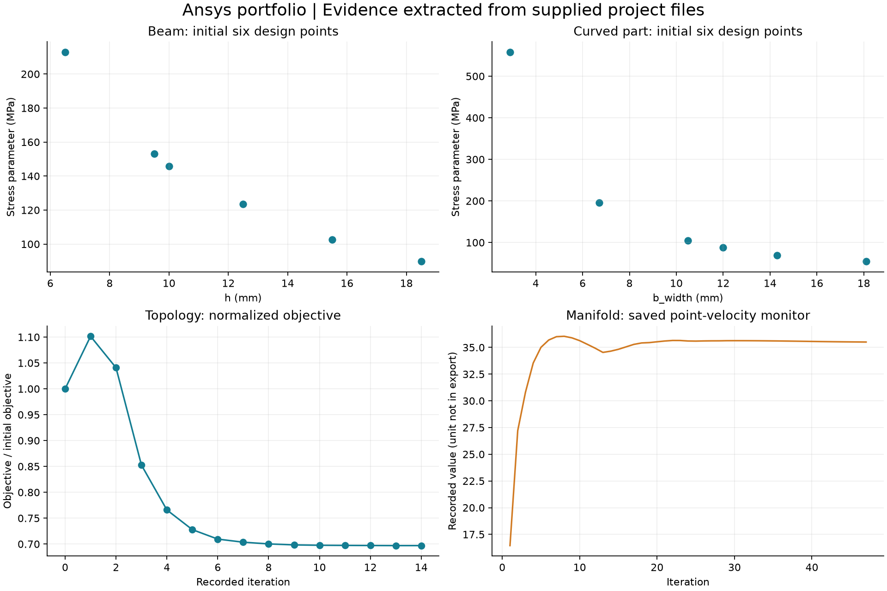

# Ansys Simulation Portfolio

Портфолио инженерных расчётов: параметрические исследования, топологическая оптимизация и CFD.

Engineering simulation studies in Ansys — project evidence, parameter studies and documented limitations.

## Проекты

| Работа | Содержание | Состояние |
| --- | --- | --- |
| [Параметризация балки](beam-parameterization.md) | Влияние размеров на напряжения и деформации | Сохранённые расчётные варианты |
| [Криволинейная деталь](curve-parameterization.md) | Параметризация ширины и анализ напряжений | Сохранённые расчётные варианты |
| [Топологическая оптимизация](topology-optimization.md) | Целевая функция и массовое ограничение | Решение найдено по журналу оптимизатора |
| [Выпускной коллектор](exhaust-manifold.md) | Fluent: геометрия, сетка, case/data | Сходимость требует проверки |

## О данных

Описания и графики подготовлены по предоставленному архиву `Ansys Lessons +Curse.rar`. CSV для балки и криволинейной детали содержат только первые шесть расчётных вариантов, а не все этапы исследования. Графики построены по сохранённым числам; новые расчёты не выполнялись.

Здесь опубликованы описания, компактные таблицы и графики. Полные исходные модели со связанными файлами и результатами опубликованы в разделе Releases; ссылки для скачивания приведены ниже. Для каждого проекта перечислены недостающие проверки; завершённая инженерная валидация не заявляется.

## Стандарт описания проекта

Каждый кейс дополняется постановкой задачи, единицами, материалами, нагрузками и закреплениями, параметрами сетки, версией Ansys, проверкой результатов и инструкцией воспроизведения. Для новых исходных материалов планируется структура `projects/<project-name>/{model,scripts,figures,reports,data}`.

## Исходные модели

| Проект | Полный архив |
| --- | --- |
| Балка | [Скачать ZIP](https://github.com/smqqcvnt11/ansys-portfolio/releases/download/models-2026-10-22/beam-parameterization.zip) |
| Криволинейная деталь | [Скачать ZIP](https://github.com/smqqcvnt11/ansys-portfolio/releases/download/models-2026-10-22/curve-parameterization.zip) |
| Топологическая оптимизация | [Скачать ZIP](https://github.com/smqqcvnt11/ansys-portfolio/releases/download/models-2026-10-22/topology-optimization.zip) |
| Выпускной коллектор | [Скачать ZIP](https://github.com/smqqcvnt11/ansys-portfolio/releases/download/models-2026-10-22/exhaust-manifold.zip) |

[Выпуск с инструкциями и контрольными суммами](https://github.com/smqqcvnt11/ansys-portfolio/releases/tag/models-2026-10-22). Архивы содержат полные папки исходных работ без изменения файлов. Распаковывайте целиком; файл .wbpj требует соответствующей папки _files.
